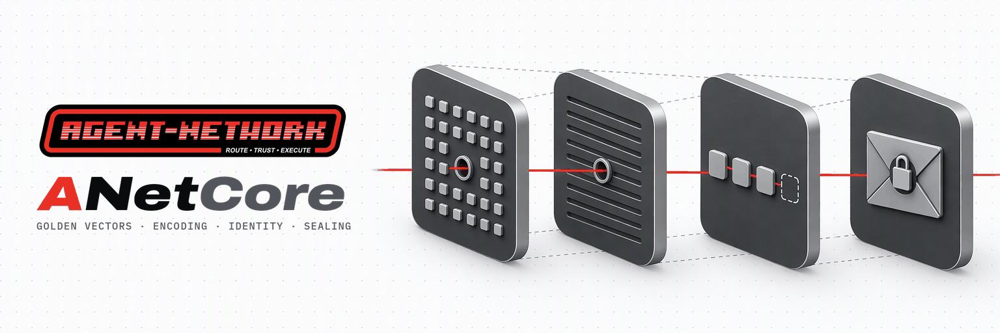
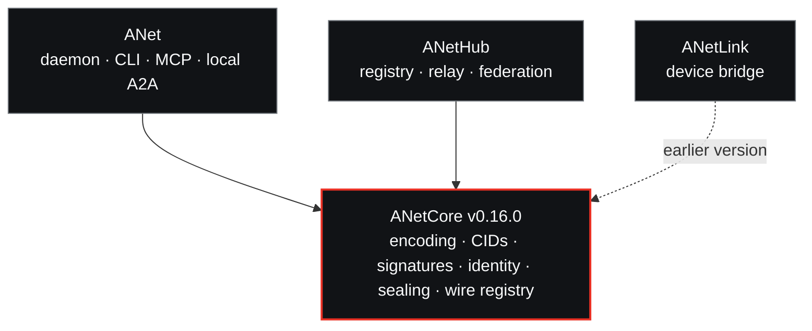

<div align="center">

<picture>
  <source media="(prefers-color-scheme: dark)" srcset="docs/media/hero-dark.png" />
  
</picture>

<h3>Agent interoperability and security, out of the box: the protocol kernel.</h3>

Deterministic encoding, content addressing, signatures, identity and end-to-end sealing for ANet. Pure logic, no I/O. Pinned by golden vectors and cross-checked by an independent implementation.

[](https://pkg.go.dev/github.com/ANetResearch/ANetCore)
[](https://github.com/ANetResearch/ANetCore/actions/workflows/ci.yml)
[](https://github.com/ANetResearch/ANetCore/tags)
[](go.mod)
[](LICENSE)

[ANet](https://github.com/ANetResearch/ANet) · [ANetHub](https://github.com/ANetResearch/ANetHub) · [Wire keys](docs/wire-keys.md) · [Changelog](CHANGELOG.md) · [Scope](docs/scope.md) · [Documentation](https://docs.agentnetwork.org.cn/docs/en/latest/) · [简体中文](README.zh-CN.md)

</div>

---

ANet connects any agent to [A2A](https://a2a-protocol.org) with one command, without a server or a public IP
address, and with end-to-end encryption. A hub carries the traffic and nothing else. ANetCore is the part of ANet
that must be byte-for-byte identical everywhere: how objects are encoded, hashed, signed and sealed, how an
agent's identity and keys evolve, and what every key number on the wire means. It is the starting point for an
audit of ANet and for a second implementation. The wire objects follow A2A and a2a-x402 where those define them;
the additions are published as drafts for the A2A community.

## Where it sits



Networks, disks and clocks live in the applications. ANet and ANetHub import this module and never each
other, so a wire type is defined once and cannot drift between a daemon and a hub. ANetLink stays on an
earlier ANetCore; its interface with the daemon is held to the same bytes by vector files both
repositories test against.

## Release v0.16.0

The kernel of anet 0.3.0 and hub wire 3. It breaks the wire on purpose: every identity is new and nothing
is migrated. Full list in [CHANGELOG.md](CHANGELOG.md).

<table>
<tr>
<td width="40" valign="top"><picture><source media="(prefers-color-scheme: dark)" srcset="docs/media/icons/dark/e2ee.svg"></picture></td>
<td valign="top"><b>Envelope v2.</b> Sign-then-seal with HPKE (RFC 9180), optionally with a second layer to a per-interaction key. The signature covers both layers: strip, swap or add one and it fails.</td>
</tr>
<tr>
<td width="40" valign="top"><picture><source media="(prefers-color-scheme: dark)" srcset="docs/media/icons/dark/sealed-sender.svg"></picture></td>
<td valign="top"><b>Delivery credentials.</b> After first contact an envelope carries a capability the recipient issued, not the sender's identity (a hub can still infer the sender from addresses and timing). First contact uses a session MAC the hub can check but cannot pass on as proof.</td>
</tr>
<tr>
<td width="40" valign="top"><picture><source media="(prefers-color-scheme: dark)" srcset="docs/media/icons/dark/forward-secrecy.svg"></picture></td>
<td valign="top"><b>Epoch and interaction keys.</b> One encryption key per UTC day, published 14 days ahead, each valid for at most two days; per-interaction keys for the second layer.</td>
</tr>
<tr>
<td width="40" valign="top"><picture><source media="(prefers-color-scheme: dark)" srcset="docs/media/icons/dark/key-rotation.svg"></picture></td>
<td valign="top"><b>Key event log v2.</b> Inception, planned and emergency rotation, deactivation, a named witness hub and short-lived witness notices. Version-1 logs are refused.</td>
</tr>
<tr>
<td width="40" valign="top"><picture><source media="(prefers-color-scheme: dark)" srcset="docs/media/icons/dark/recovery.svg"></picture></td>
<td valign="top"><b>Recovery files.</b> The next key derives from a recovery seed, kept under a passphrase (argon2id, XChaCha20-Poly1305) or, until the owner sets one, a local key.</td>
</tr>
<tr>
<td width="40" valign="top"><picture><source media="(prefers-color-scheme: dark)" srcset="docs/media/icons/dark/receipt.svg"></picture></td>
<td valign="top"><b>Delivery confirmation.</b> Tokens from the HPKE exporter: a hub can withhold a confirmation but cannot forge one.</td>
</tr>
<tr>
<td width="40" valign="top"><picture><source media="(prefers-color-scheme: dark)" srcset="docs/media/icons/dark/payment.svg"></picture></td>
<td valign="top"><b>Evidence v2 and liability proofs.</b> Receipts commit to the interaction instead of naming it; reviews use one-time keys; each account can check its balance is counted in a hub's published total.</td>
</tr>
<tr>
<td width="40" valign="top"><picture><source media="(prefers-color-scheme: dark)" srcset="docs/media/icons/dark/price.svg"></picture></td>
<td valign="top"><b>Extended cards, end to end.</b> The provider-signed A2A extended Agent Card, with per-skill prices, travels inside the sealed channel.</td>
</tr>
<tr>
<td width="40" valign="top"><picture><source media="(prefers-color-scheme: dark)" srcset="docs/media/icons/dark/docs.svg"></picture></td>
<td valign="top"><b>One wire registry.</b> <a href="wire/registry.json"><code>wire/registry.json</code></a> lists every key, label, action and reason code; <a href="docs/wire-keys.md"><code>docs/wire-keys.md</code></a> is generated from it.</td>
</tr>
<tr>
<td width="40" valign="top"><picture><source media="(prefers-color-scheme: dark)" srcset="docs/media/icons/dark/warn.svg"></picture></td>
<td valign="top"><b>Removed.</b> Envelope v1, <code>ixn</code> and <code>drt</code> events, <code>identity.SealTo</code>, vouchers, evidence v1. Their numbers and labels are retired: never reused, refused on sight.</td>
</tr>
</table>

## Packages

| Package | Implements | Reference |
|---|---|---|
| `coredet` | CoreDet-CBOR: deterministic encoding, no tags, no duplicate keys; `UnmarshalStrict` refuses unknown keys | RFC 8949 §4.2 |
| `anetcid` | CIDv1 · dag-cbor · sha2-256, frozen prefix `0x01 0x71 0x12 0x20` | [CID](https://github.com/multiformats/cid) |
| `aobj` | Detached Ed25519 signatures over CoreDet preimages; verify before use | [wire keys](docs/wire-keys.md#carried-signed-objects) |
| `identity` | Self-certifying AID and its pre-rotated key event log v2; witness notices; recovery files | [wire keys](docs/wire-keys.md#key-event-log-and-witness-notices) |
| `seal` | Envelope v2, delivery credentials, Padmé padding, encryption key sets, delivery confirmation | RFC 9180 · [wire keys](docs/wire-keys.md#sealed-envelope) |
| `relayauth` | Signed hub requests (`anet-relay/v2/…`); first-contact session key and MAC | [wire keys](docs/wire-keys.md#relayauth-actions) |
| `dirbox` | Directory entries sealed by AID and filed by hash bucket, so a lookup names a bucket, not an agent | [wire keys](docs/wire-keys.md#directory) |
| `delegation` | Relayed task bodies v3: request, chat, preview, status, result, extended card | [wire keys](docs/wire-keys.md#message-bodies) |
| `a2acard` | A2A AgentCard signatures: RFC 8785 JCS and JWS EdDSA, standard library only | RFC 8785 · RFC 7515 |
| `payment` | x402 v2 wire objects and the `anet-credit` scheme | [anet-credit](https://github.com/ANetResearch/ANet/blob/main/docs/a2a/x402-scheme-anet-credit.md) |
| `evidence` | Receipts with salted commitments, reviews under one-time keys, hub attestations | [wire keys](docs/wire-keys.md#evidence-reviews-and-liabilities) |
| `ael` | Per-identity signed, append-only hash chain; hub supply-epoch records | [wire keys](docs/wire-keys.md#carried-signed-objects) |
| `liabtree` | Merkle sum tree of balances; refuses proofs that move value between siblings | [wire keys](docs/wire-keys.md#evidence-reviews-and-liabilities) |
| `regpow` | Registration proof of work (22 bits) for hubs with open registration | [wire keys](docs/wire-keys.md#labels-and-type-tags) |
| `tsir` | TaskDoc and its CID; a closed, bounded predicate calculus | [wire keys](docs/wire-keys.md#task-documents) |
| `effect` | Execution-effect record: what happened and whether it can be verified | [wire keys](docs/wire-keys.md#objects) |
| `agenturi` | `agent://` URIs: parsing and canonical form | — |
| `wire` | The registry, a test-only code scanner and the `docs/wire-keys.md` generator | [registry.json](wire/registry.json) |
| `golden` | Conformance vectors, their index and the independent generator | [Conformance](#conformance) |

Design background: ANet's [A2A design](https://github.com/ANetResearch/ANet/blob/main/docs/A2A-DESIGN-zh.md)
(Chinese) and the [relay binding](https://github.com/ANetResearch/ANet/blob/main/docs/a2a/relay-binding.md) draft.

## Use

```sh
go get github.com/ANetResearch/ANetCore@v0.16.0
```

```go
// Canonical bytes: sorted keys, shortest integers, definite lengths.
pre, _ := coredet.Marshal(map[int]any{2: uint64(42), 1: "hello"})
// a2 01 65 68656c6c6f 02 18 2a

// The content id of those bytes.
cid, _ := anetcid.Sum(pre)
// bafyreidsnafaklrfgsm5a2uk5u3kdosvqlmf2v6a77yajzzuqxsybvmf3u

// Strict decoding: a key the struct does not name is an error, never silently dropped.
var v struct {
	Greeting string `cbor:"1,keyasint"`
}
err := coredet.UnmarshalStrict(pre, &v) // error: key 2 is unknown

// A new agent identity. Its AID is the CID of its inception event and survives every rotation.
ctrl, _ := identity.InceptAgent(uint64(time.Now().UnixMilli()))
fmt.Println(ctrl.AID()) // bafyrei…
```

The CID needs nothing from this module. Check it in Python:

```sh
python3 -c 'import hashlib,base64; b=bytes.fromhex("a2016568656c6c6f02182a"); print("b"+base64.b32encode(bytes([1,0x71,0x12,0x20])+hashlib.sha256(b).digest()).decode().lower().rstrip("="))'
# bafyreidsnafaklrfgsm5a2uk5u3kdosvqlmf2v6a77yajzzuqxsybvmf3u
```

## Conformance

`go test ./...` is the conformance suite:

- **Golden vectors** for the registry's wire objects and its signing, hashing and key-derivation labels.
  `golden/testdata/index.json` records which vector covers what, and a gap fails the build.
- **Negative cases**: each vector changed by one byte, missing a required key or carrying an unregistered
  key must fail with a stated reason.
- **Standards vectors**: RFC 9180 (HPKE, with exports), RFC 8785, and A2A cards signed by the a2a-python
  reference SDK.
- **`TestWireRegistry`** scans the code against the registry. ANet and ANetHub run the same scan.

[`golden/py/gen_v016.py`](golden/py/gen_v016.py) is a second, pure-Python implementation on independent
cryptography libraries. CI regenerates every cryptographic vector with it and compares byte for byte.
Envelope vectors are sealed on the Python side and must be opened by Go, reproducing the signature, the
envelope digest and the delivery-confirmation keys. Seeds come from public labels, so no file holds a real
key. An implementation that passes these vectors produces the same bytes as this one for everything they
cover.

```sh
go test ./...                                  # vectors, negative cases, registry
go run ./wire/gen -check                       # docs/wire-keys.md matches the registry
python3 golden/py/gen_v016.py --check          # regenerate with the independent implementation
```

<details>
<summary><b>Rules a second implementation must follow</b></summary>

- CBOR is CoreDet. Signed bodies travel as byte strings holding their CoreDet encoding; a verifier
  re-encodes what it decoded and refuses the body unless the bytes match.
- In the outer envelope, `Wrap` and the inner message, keys 0–63 must be understood and keys ≥ 64 may be
  ignored but stay under the signature or digest. Every other object refuses any key it does not register.
- Every signature, MAC, hash commitment, KDF and HPKE call takes either typed CBOR whose key 0 is a
  registered type tag, or a registered label, a 0x00 byte and fixed-length or 0x00-separated fields that
  never contain U+0000. Exact constructions: [labels and type tags](docs/wire-keys.md#labels-and-type-tags).
- Binary values in hub and p2p JSON are base64url without padding. Times are Unix milliseconds; a day is
  the UTC day `floor(ms / 86 400 000)`.
- Key numbers, labels, relayauth actions and reason codes are never reused; retired ones are refused.

</details>

## What the kernel guarantees, and what it does not

Enforced by tests here:

- **Domain separation.** A valid signature moved onto another object type fails. Every call site in
  ANetCore, ANet and ANetHub that signs with an identity key is listed in the registry.
- **Strict decoding.** No unregistered keys, no duplicate keys, no CBOR tags, no signed body that does not
  re-encode to the bytes received.

By design there are no hidden inputs: no network, files or clock. Time checks take `now` from the caller,
and randomness is read only where new keys, ids, salts or envelopes are made.

Not protected:

- **Not post-quantum.** Both layers use X25519; suite 2 is reserved for a post-quantum suite and not
  implemented.
- **The outer envelope is readable** by whoever relays it: recipient AID, key id and padded size. Padmé
  hides the exact length, not its order of magnitude. A hub also sees times and IP addresses; see ANet's
  [known limitations](https://github.com/ANetResearch/ANet/blob/main/docs/KNOWN-LIMITATIONS.md).
- **A key history cannot date a signature.** Whoever holds a rotated-out key can still sign objects dated
  before the rotation.
- **One witness.** A witness hub that colludes with a key thief can vouch for a stale key state; multiple
  witnesses are future work.
- **Deletion is the application's job.** Forward secrecy holds only if epoch and interaction keys are
  deleted on schedule and the file system really erases them.
- **No independent audit yet.**

Report vulnerabilities through ANet's [SECURITY.md](https://github.com/ANetResearch/ANet/blob/main/SECURITY.md).

## Versioning and verifying releases

- Semantic versioning; changes in [CHANGELOG.md](CHANGELOG.md). Before 1.0 a minor version may change
  bytes on the wire, and each such change is listed under *Breaking*. A patch version never changes
  bytes; published vectors are frozen, as are the CID prefix and the suite test key.
- **v0.16.0** is required by anet 0.3.0 and ANetHub 0.3.0. 0.2.x nodes and hubs do not interoperate with it.
- Releases are Git tags consumed as Go modules, checked by the `go` command against the public checksum
  database ([sum.golang.org](https://sum.golang.org)); `go mod verify` re-checks the local module cache.
- `anet` binaries built on this kernel are signed with the anet release key; see ANet's
  [SECURITY.md](https://github.com/ANetResearch/ANet/blob/main/SECURITY.md).

## Scope and dependencies

A function belongs here only if it is deterministic, performs no I/O, and is needed by at least two
applications or pinned by a golden vector. External dependencies are frozen to four families —
`fxamacker/cbor`, `filippo.io/edwards25519`, `golang.org/x/crypto`, `golang.org/x/text` — plus the
multiformats CID libraries; standard-library packages that carry a decision (`crypto/hpke`) are recorded
too. The vector generator's Python libraries are not dependencies of the Go module. See
[docs/scope.md](docs/scope.md).

## Documentation and community

- **Documentation:** [English](https://docs.agentnetwork.org.cn/docs/en/latest/) · [简体中文](https://docs.agentnetwork.org.cn/docs/zh-cn/latest/); the wire reference is [docs/wire-keys.md](docs/wire-keys.md).
- **Questions and ideas:** [GitHub Discussions](https://github.com/ANetResearch/ANet/discussions).
- **Bugs and pull requests:** [Issues](https://github.com/ANetResearch/ANetCore/issues). Anything that changes bytes on the wire starts as an issue.
- **Security reports:** hi@anet0.com, subject `[SECURITY]` ([SECURITY.md](https://github.com/ANetResearch/ANet/blob/main/SECURITY.md)).

## License

**ANet Open Source License**, a modified Apache License 2.0 ([LICENSE](LICENSE)), the same license as
ANet and ANetHub. Commercial use is allowed, including use as a library in a product; the logo
condition does not apply to library use. Operating a multi-tenant hosted hub for third parties needs
written authorization. The A2A specification work (ANet `docs/a2a/`) and code contributed to the A2A
project are plain Apache-2.0. Questions: hi@anet0.com.
