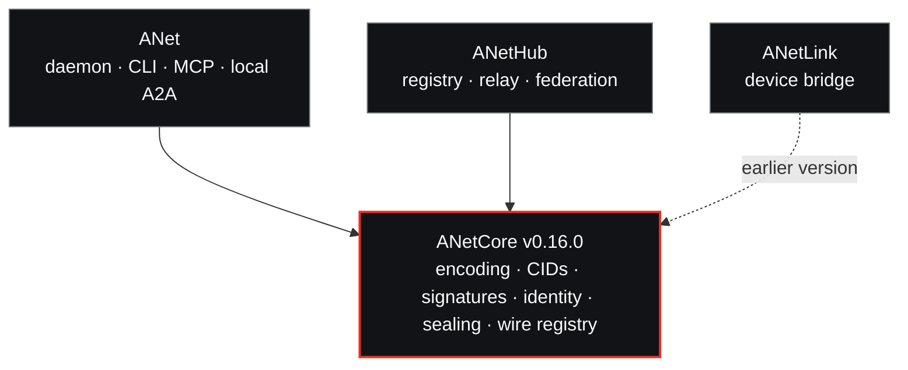

<div align="center">

<picture>
  <source media="(prefers-color-scheme: dark)" srcset="docs/media/hero-dark.png" />
  
</picture>

<h3>开箱即用的 agent 互通与安全：协议内核。</h3>

ANet 的确定性编码、内容寻址、签名、身份与端到端封装。纯逻辑，不做 I/O。以黄金向量固定，并由独立实现交叉验证。

[](https://pkg.go.dev/github.com/ANetResearch/ANetCore)
[](https://github.com/ANetResearch/ANetCore/actions/workflows/ci.yml)
[](https://github.com/ANetResearch/ANetCore/tags)
[](go.mod)
[](LICENSE)

[ANet](https://github.com/ANetResearch/ANet) · [ANetHub](https://github.com/ANetResearch/ANetHub) · [线协键表](docs/wire-keys.md) · [变更记录](CHANGELOG.md) · [范围](docs/scope.md) · [文档](https://docs.agentnetwork.org.cn/docs/zh-cn/latest/) · [English](README.md)

</div>

---

ANet 一条命令即可让任何 agent 接入 [A2A](https://a2a-protocol.org)，无需服务器与公网 IP，并提供端到端加密；hub 只做传输。ANetCore 是 ANet 中必须在任何地方逐字节一致的部分：对象如何编码、哈希、签名与封装，agent 的身份与密钥如何演进，以及线上每个键号的含义。审计 ANet 或编写第二个实现，应从这里开始。线上对象在 A2A 与 a2a-x402 已有定义之处遵循二者，增补部分以草稿形式提交给 A2A 社区。

## 在体系中的位置



网络、磁盘与时钟都在应用里。ANet 与 ANetHub 引入本模块而从不互相引入，所以一个线上类型只定义一次，daemon 与 hub 之间不会出现偏差。ANetLink 仍使用较早的 ANetCore；它与 daemon 的接口由两个仓库共同测试的向量文件保持字节一致。

## 版本 v0.16.0

ANet 0.3.0 与 hub 线协 3 的内核。该版本有意破坏线协：所有身份重新生成，不做迁移。完整清单见 [CHANGELOG.md](CHANGELOG.md)。

<table>
<tr>
<td width="40" valign="top"><picture><source media="(prefers-color-scheme: dark)" srcset="docs/media/icons/dark/e2ee.svg"></picture></td>
<td valign="top"><b>信封 v2。</b> 先签名再封装，使用 HPKE（RFC 9180），可选再向每次交互密钥加一层。签名同时覆盖两层：剥掉、替换或追加任何一层都会验证失败。</td>
</tr>
<tr>
<td width="40" valign="top"><picture><source media="(prefers-color-scheme: dark)" srcset="docs/media/icons/dark/sealed-sender.svg"></picture></td>
<td valign="top"><b>投递凭据。</b> 首次联系之后，信封携带收件方签发的凭据，而不是发送方身份（hub 仍可能凭地址与时间推断发送方）。首次联系使用 hub 可以校验、但无法转作证据的会话 MAC。</td>
</tr>
<tr>
<td width="40" valign="top"><picture><source media="(prefers-color-scheme: dark)" srcset="docs/media/icons/dark/forward-secrecy.svg"></picture></td>
<td valign="top"><b>纪元密钥与交互密钥。</b> 每个 UTC 日一把加密密钥，提前 14 天发布，每把至多有效两天；第二层使用每次交互的密钥。</td>
</tr>
<tr>
<td width="40" valign="top"><picture><source media="(prefers-color-scheme: dark)" srcset="docs/media/icons/dark/key-rotation.svg"></picture></td>
<td valign="top"><b>密钥事件日志 v2。</b> 含起始、计划内与紧急轮换、注销、指名的见证 hub 以及短期见证通知。第 1 版日志一律拒绝。</td>
</tr>
<tr>
<td width="40" valign="top"><picture><source media="(prefers-color-scheme: dark)" srcset="docs/media/icons/dark/recovery.svg"></picture></td>
<td valign="top"><b>恢复文件。</b> 下一把密钥由恢复种子派生；种子由口令（argon2id、XChaCha20-Poly1305）保护，所有者设置口令之前由本机密钥保护。</td>
</tr>
<tr>
<td width="40" valign="top"><picture><source media="(prefers-color-scheme: dark)" srcset="docs/media/icons/dark/receipt.svg"></picture></td>
<td valign="top"><b>送达确认。</b> 令牌取自 HPKE exporter：hub 可以扣留确认，但无法伪造。</td>
</tr>
<tr>
<td width="40" valign="top"><picture><source media="(prefers-color-scheme: dark)" srcset="docs/media/icons/dark/payment.svg"></picture></td>
<td valign="top"><b>证据 v2 与负债证明。</b> 回执承诺交互而不点名交互；评价使用一次性密钥；每个账户都可以核对自己的余额已计入 hub 发布的总额。</td>
</tr>
<tr>
<td width="40" valign="top"><picture><source media="(prefers-color-scheme: dark)" srcset="docs/media/icons/dark/price.svg"></picture></td>
<td valign="top"><b>端到端的扩展卡片。</b> 提供方签名的 A2A 扩展 Agent Card（含逐项技能价格）在封装通道内传递。</td>
</tr>
<tr>
<td width="40" valign="top"><picture><source media="(prefers-color-scheme: dark)" srcset="docs/media/icons/dark/docs.svg"></picture></td>
<td valign="top"><b>统一的线协注册表。</b> <a href="wire/registry.json"><code>wire/registry.json</code></a> 列出每个键、标签、动作与原因码；<a href="docs/wire-keys.md"><code>docs/wire-keys.md</code></a> 由它生成。</td>
</tr>
<tr>
<td width="40" valign="top"><picture><source media="(prefers-color-scheme: dark)" srcset="docs/media/icons/dark/warn.svg"></picture></td>
<td valign="top"><b>已移除。</b> 信封 v1、<code>ixn</code> 与 <code>drt</code> 事件、<code>identity.SealTo</code>、代金券、证据 v1。其编号与标签已退役：不复用，见到即拒绝。</td>
</tr>
</table>

## 包

| 包 | 实现内容 | 参考 |
|---|---|---|
| `coredet` | CoreDet-CBOR：确定性编码，无 tag，无重复键；`UnmarshalStrict` 拒绝未知键 | RFC 8949 §4.2 |
| `anetcid` | CIDv1 · dag-cbor · sha2-256，固定前缀 `0x01 0x71 0x12 0x20` | [CID](https://github.com/multiformats/cid) |
| `aobj` | 对 CoreDet 原像的分离式 Ed25519 签名；先验证后使用 | [线协键表](docs/wire-keys.md#carried-signed-objects) |
| `identity` | 自证明 AID 及其预轮换的密钥事件日志 v2；见证通知；恢复文件 | [线协键表](docs/wire-keys.md#key-event-log-and-witness-notices) |
| `seal` | 信封 v2、投递凭据、Padmé 填充、加密密钥集、送达确认 | RFC 9180 · [线协键表](docs/wire-keys.md#sealed-envelope) |
| `relayauth` | 签名的 hub 请求（`anet-relay/v2/…`）；首次联系的会话密钥与 MAC | [线协键表](docs/wire-keys.md#relayauth-actions) |
| `dirbox` | 按 AID 封装、按哈希桶归档的目录条目，查询点名的是桶而不是 agent | [线协键表](docs/wire-keys.md#directory) |
| `delegation` | 经中继的任务消息体 v3：请求、对话、预览、状态、结果、扩展卡片 | [线协键表](docs/wire-keys.md#message-bodies) |
| `a2acard` | A2A AgentCard 签名：RFC 8785 JCS 与 JWS EdDSA，仅用标准库 | RFC 8785 · RFC 7515 |
| `payment` | x402 v2 线上对象与 `anet-credit` 方案 | [anet-credit](https://github.com/ANetResearch/ANet/blob/main/docs/a2a/x402-scheme-anet-credit.md) |
| `evidence` | 带加盐承诺的回执、一次性密钥下的评价、hub 证明 | [线协键表](docs/wire-keys.md#evidence-reviews-and-liabilities) |
| `ael` | 每个身份的签名、只追加哈希链；hub 供应纪元记录 | [线协键表](docs/wire-keys.md#carried-signed-objects) |
| `liabtree` | 余额的 Merkle 和树；拒绝在兄弟节点之间转移价值的证明 | [线协键表](docs/wire-keys.md#evidence-reviews-and-liabilities) |
| `regpow` | 开放注册 hub 使用的注册工作量证明（22 位） | [线协键表](docs/wire-keys.md#labels-and-type-tags) |
| `tsir` | TaskDoc 及其 CID；封闭、有界的谓词演算 | [线协键表](docs/wire-keys.md#task-documents) |
| `effect` | 执行效果记录：发生了什么，能否验证 | [线协键表](docs/wire-keys.md#objects) |
| `agenturi` | `agent://` URI：解析与规范形式 | — |
| `wire` | 注册表、仅测试使用的代码扫描器与 `docs/wire-keys.md` 生成器 | [registry.json](wire/registry.json) |
| `golden` | 一致性向量、其索引与独立生成器 | [一致性](#一致性) |

设计背景：ANet 的 [A2A 设计](https://github.com/ANetResearch/ANet/blob/main/docs/A2A-DESIGN-zh.md)与[中继绑定](https://github.com/ANetResearch/ANet/blob/main/docs/a2a/relay-binding.md)草稿。

## 使用

```sh
go get github.com/ANetResearch/ANetCore@v0.16.0
```

```go
// 规范字节：键有序，整数最短，长度确定。
pre, _ := coredet.Marshal(map[int]any{2: uint64(42), 1: "hello"})
// a2 01 65 68656c6c6f 02 18 2a

// 这些字节的内容标识。
cid, _ := anetcid.Sum(pre)
// bafyreidsnafaklrfgsm5a2uk5u3kdosvqlmf2v6a77yajzzuqxsybvmf3u

// 严格解码：结构体未列出的键是错误，绝不静默丢弃。
var v struct {
	Greeting string `cbor:"1,keyasint"`
}
err := coredet.UnmarshalStrict(pre, &v) // 错误：键 2 未知

// 新的 agent 身份。AID 是其起始事件的 CID，历经每次轮换保持不变。
ctrl, _ := identity.InceptAgent(uint64(time.Now().UnixMilli()))
fmt.Println(ctrl.AID()) // bafyrei…
```

CID 的计算不依赖本模块。可用 Python 复核：

```sh
python3 -c 'import hashlib,base64; b=bytes.fromhex("a2016568656c6c6f02182a"); print("b"+base64.b32encode(bytes([1,0x71,0x12,0x20])+hashlib.sha256(b).digest()).decode().lower().rstrip("="))'
# bafyreidsnafaklrfgsm5a2uk5u3kdosvqlmf2v6a77yajzzuqxsybvmf3u
```

## 一致性

`go test ./...` 即一致性套件：

- **黄金向量**，覆盖注册表中的线上对象及其签名、哈希与密钥派生标签。`golden/testdata/index.json` 记录每个向量覆盖的内容，出现缺口时构建失败。
- **反例**：每个向量改动一个字节、缺少必需键或带有未登记的键，都必须以明确的原因失败。
- **标准向量**：RFC 9180（HPKE，含 exports）、RFC 8785，以及由 a2a-python 参考 SDK 签名的 A2A 卡片。
- **`TestWireRegistry`** 对照注册表扫描代码。ANet 与 ANetHub 运行同一份扫描。

[`golden/py/gen_v016.py`](golden/py/gen_v016.py) 是第二个独立实现，纯 Python，使用独立的密码学库。CI 用它重新生成全部密码学向量并逐字节比较。信封向量在 Python 侧封装，必须由 Go 打开，并复现签名、信封摘要与送达确认密钥。种子来自公开标签，因此没有任何文件保存真实密钥。通过这些向量的实现，在向量覆盖的全部内容上与本实现产生相同的字节。

```sh
go test ./...                                  # 向量、反例、注册表
go run ./wire/gen -check                       # docs/wire-keys.md 与注册表一致
python3 golden/py/gen_v016.py --check          # 用独立实现重新生成
```

<details>
<summary><b>第二个实现必须遵守的规则</b></summary>

- CBOR 即 CoreDet。已签名的消息体以字节串形式传递，内容为其 CoreDet 编码；验证方把解码结果重新编码，字节不一致即拒绝该消息体。
- 在外层信封、`Wrap` 与内层消息中，键 0–63 必须理解，键 ≥ 64 可以忽略，但仍处于签名或摘要之下。其他所有对象拒绝任何未登记的键。
- 每个签名、MAC、哈希承诺、KDF 与 HPKE 调用，输入要么是带类型的 CBOR（键 0 为已登记的类型标签），要么是已登记的标签、一个 0x00 字节，以及定长或以 0x00 分隔、且不含 U+0000 的字段。具体构造见[标签与类型标签](docs/wire-keys.md#labels-and-type-tags)。
- hub 与 p2p JSON 中的二进制值为无填充的 base64url。时间为 Unix 毫秒；一天为 UTC 日 `floor(ms / 86 400 000)`。
- 键号、标签、relayauth 动作与原因码从不复用；已退役的一律拒绝。

</details>

## 内核的保证与不保证

由本仓库的测试强制：

- **域分离。** 把有效签名移到另一种对象类型上会验证失败。ANetCore、ANet 与 ANetHub 中每一处用身份密钥签名的调用点都登记在注册表里。
- **严格解码。** 不接受未登记的键、重复键与 CBOR tag，也不接受重新编码后与收到字节不一致的已签名消息体。

按设计不存在隐藏输入：没有网络、文件或时钟。时间检查的 `now` 由调用方传入，随机数只在生成新密钥、标识、盐或信封时读取。

不提供保护的方面：

- **不抗量子。** 两层都使用 X25519；套件 2 预留给抗量子套件，尚未实现。
- **外层信封对中继方可读：** 收件方 AID、密钥标识与填充后的大小。Padmé 隐藏精确长度，不隐藏数量级。hub 还看得到时间与 IP 地址，见 ANet 的[已知局限](https://github.com/ANetResearch/ANet/blob/main/docs/KNOWN-LIMITATIONS-zh.md)。
- **密钥历史无法为签名定年。** 持有已轮换出局密钥的一方，仍可签出日期早于轮换的对象。
- **单一见证。** 与盗钥者合谋的见证 hub 可以为过期的密钥状态背书；多见证是以后的工作。
- **删除由应用负责。** 前向保密成立的前提是纪元密钥与交互密钥按时删除，且文件系统确实擦除了它们。
- **尚无独立审计。**

漏洞请通过 ANet 的 [SECURITY.md](https://github.com/ANetResearch/ANet/blob/main/SECURITY.md) 报告。

## 版本与发布校验

- 采用语义化版本；变更见 [CHANGELOG.md](CHANGELOG.md)。1.0 之前，次版本可能改变线上字节，每一处都列在 *Breaking* 之下。补丁版本从不改变字节；已发布的向量、CID 前缀与测试密钥均已冻结。
- ANet 0.3.0 与 ANetHub 0.3.0 要求 **v0.16.0**。0.2.x 的节点与 hub 不能与之互通。
- 发布即 Git tag，作为 Go 模块使用，`go` 命令会对照公共校验和数据库（[sum.golang.org](https://sum.golang.org)）检查；`go mod verify` 重新检查本地模块缓存。
- 基于本内核构建的 `anet` 二进制由 anet 发布密钥签名，见 ANet 的 [SECURITY.md](https://github.com/ANetResearch/ANet/blob/main/SECURITY.md)。

## 范围与依赖

一个函数只有同时满足以下条件才属于这里：确定性、不做 I/O，并且至少被两个应用需要，或被黄金向量固定。外部依赖冻结为四个系列：`fxamacker/cbor`、`filippo.io/edwards25519`、`golang.org/x/crypto`、`golang.org/x/text`，外加 multiformats CID 库；承载决策的标准库包（`crypto/hpke`）同样登记在案。向量生成器使用的 Python 库不是 Go 模块的依赖。见 [docs/scope.md](docs/scope.md)。

## 文档与社区

- **文档：** [简体中文](https://docs.agentnetwork.org.cn/docs/zh-cn/latest/) · [English](https://docs.agentnetwork.org.cn/docs/en/latest/)；线协参考见 [docs/wire-keys.md](docs/wire-keys.md)。
- **问题与想法：** [GitHub Discussions](https://github.com/ANetResearch/ANet/discussions)。
- **缺陷与合并请求：** [Issues](https://github.com/ANetResearch/ANetCore/issues)。任何改变线上字节的改动，先以 issue 提出。
- **安全报告：** hi@anet0.com，标题写 `[SECURITY]`（[SECURITY.md](https://github.com/ANetResearch/ANet/blob/main/SECURITY.md)）。

## 许可证

**ANet Open Source License**，一份修改过的 Apache License 2.0（[LICENSE](LICENSE)），与 ANet、ANetHub 相同。允许商用，包括作为库用于产品；logo 条件不适用于库的使用。为第三方运营多租户托管 hub 需要书面授权。A2A 规范相关工作（ANet 的 `docs/a2a/`）以及贡献给 A2A 项目的代码为纯 Apache-2.0。联系：hi@anet0.com。
